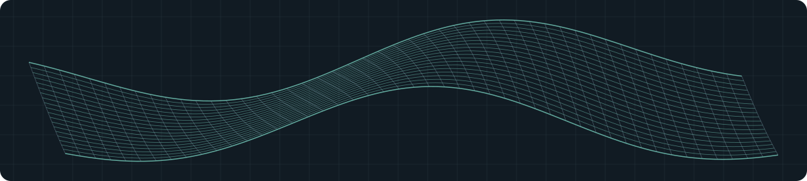

# Hussein Hamdan

**Computational Designer | Complex Geometry & Adaptive Design Systems | BIM Automation**

**Grasshopper · Rhino.Inside.Revit · pyRevit · C# · Python**

I work at the intersection of computational design and software development. I build workflows for complex geometry, adaptive design systems and BIM automation, alongside web and Android apps that solve problems I encounter in daily life.

## Design through computation

- **Complex geometry & adaptive systems** — developing parametric workflows with Grasshopper.
- **Rhino ↔ Revit workflows** — connecting design geometry with BIM through Rhino.Inside.Revit.
- **BIM automation** — building scripts and tools with pyRevit, C# and Python to reduce repetitive work.

## Selected work

### [Rhino → Revit Import Tracker](https://github.com/husseinhamdan01/HTML-Viewer/blob/main/Rhino%20To%20Revit%20Excute%20Time.html)

A browser-based comparison of Rhino-to-Revit import methods. It visualizes execution times for component family forms, meshes and DirectShapes to help assess performance and geometry trade-offs.

### Raqeem · Android & web

A personal app ecosystem I’m developing for tasks, expenses, fitness, habits, reminders, notes and tracking. It brings these workflows into an Android app and a web dashboard, with shared interfaces and synchronization.

The source is currently private.

## Tools I work with

| Computational design & BIM | App development |
| --- | --- |
| Grasshopper, Rhino.Inside.Revit, pyRevit | Python, JavaScript, TypeScript |
| C#, Python | React, Capacitor, Android, Vercel |

I’m interested in making computational design workflows more practical and building software that is clear, useful and worth maintaining.
